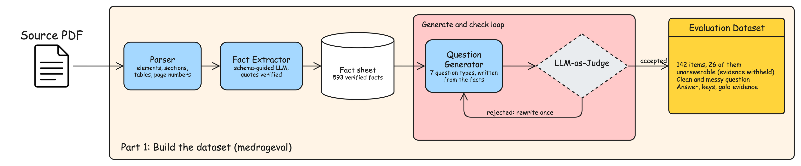
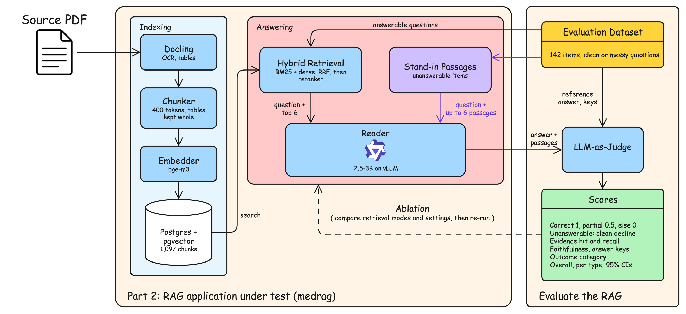

# MedRAGEval: Writeup

MedRAGEval creates questions and reference answers from a medical PDF, then uses them to test a retrieval-augmented generation (RAG) system.

The example uses **NICE TA1063**, a 578-page collection of 13 committee papers on capivasertib with fulvestrant for advanced breast cancer.

## Part 1: Building the dataset

The pipeline has three main steps:

1. **Parse the PDF.** Extract text and tables, use OCR for scanned pages, and keep page numbers for tracing evidence.
2. **Extract facts.** An LLM records facts with supporting quotes. Code checks that each quote appears in the source and contains the numbers used in the fact.
3. **Generate questions.** An LLM writes questions from these facts. Code and an LLM judge check them. Failed questions get one rewrite before being rejected.

For TA1063, this produced **593 checked facts and 142 accepted questions** from 183 candidates.

| Question type | Count |
|:--------------|------:|
| Factual | 26 |
| Numerical | 26 |
| Unanswerable | 26 |
| Attribution | 20 |
| Summary | 18 |
| Comparative | 16 |
| Multihop | 10 |

Each question includes a reference answer and supporting evidence. Most are clinical; 32 cover the economic model or cost-effectiveness results.

Two variations help test the system:

- **Missing evidence:** An answerable question is paired with related passages that do not contain the answer. A judge screens these passages. The model should say it cannot answer.
- **Messy wording:** Each question gets a version with shorthand, typos or missing punctuation. Numbers stay unchanged. These rewrites are unchecked, so some may also change the meaning.

The dataset is saved as JSONL. Cached LLM responses let the same settings reproduce it without new calls.

## Part 2: Testing the RAG

The RAG processes the PDF independently of the dataset pipeline. The same dataset can test other RAG systems that use this PDF.

### How it answers

- **Index:** Docling parses the PDF into 1,097 chunks. bge-m3 embeds them, and Postgres with pgvector stores them.
- **Search:** BM25 and dense search find relevant passages. bge-reranker-v2-m3 reranks the results, and the top 6 go to the reader.
- **Reader:** Qwen2.5-3B-Instruct runs locally through vLLM. It must answer from the passages, cite them, avoid guessing redacted values, and say when the answer is missing.

Unanswerable questions skip normal search and use the screened passages with the evidence removed.

### How it is scored

Clean and messy questions are tested in separate runs, using the same reference answers.

Evaluation checks three things:

- **Retrieval:** Did the reader receive the supporting quotes? A matching page alone does not count.
- **Answer details:** Does the reply include the required facts and numbers?
- **Answer quality:** An LLM judge checks correctness, support for claims and coverage of summary keypoints.

The judge scores answers as **correct (1), partial (0.5), or incorrect/declined (0)**. For unanswerable questions, declining scores 1.

Each run saves replies and scores in `responses.jsonl`, with overall results and results by question type in `eval_report.json`.

### Results

Each run uses 142 questions. Score and MRR range from 0 to 1; other metrics are percentages.

**Clean questions**

| Metric | [BM25](../data/runs/ablation/bm25/eval_report.json) | [Dense](../data/runs/ablation/dense/eval_report.json) | [Hybrid](../data/runs/ablation/hybrid/eval_report.json) | [Hybrid + rerank](../data/runs/ta1063/eval_report.json) | [+ document boost](../data/runs/ablation-boost8/hybrid+rerank/eval_report.json) | [+ boost + nearby chunks](../data/runs/ablation-boosted/hybrid+rerank/eval_report.json) |
|:-------|------:|------:|------:|------:|------:|------:|
| Score | 0.528 | 0.496 | 0.514 | 0.542 | 0.553 | 0.592 |
| Evidence hit rate | 56.9% | 44.8% | 51.7% | 60.3% | 69.0% | 70.7% |
| Evidence recall | 52.3% | 42.8% | 49.7% | 55.9% | 63.4% | 67.0% |
| All-evidence rate | 49.1% | 41.4% | 48.3% | 52.6% | 57.8% | 62.9% |
| MRR | 0.414 | 0.268 | 0.360 | 0.398 | 0.405 | 0.407 |
| Candidate recall | 74.2% | 60.5% | 72.9% | 72.9% | 75.3% | 75.3% |
| Key recall | 62.8% | 59.0% | 62.8% | 67.3% | 69.8% | 72.1% |
| Faithfulness | 79.3% | 73.4% | 73.9% | 76.2% | 75.9% | 77.7% |
| Summary completeness | 23.6% | 28.7% | 36.1% | 34.7% | 35.2% | 37.5% |
| Abstention rate | 12.0% | 17.6% | 12.7% | 14.1% | 8.5% | 9.2% |

The last two settings add document boosting to hybrid + rerank, using the top 8 passages. The final setting also includes nearby chunks. Boosting gives more weight to documents named in the question.

**Clean vs messy: hybrid + rerank**

| Metric | [Clean](../data/runs/ta1063/eval_report.json) | [Messy](../data/runs/ta1063-messy/eval_report.json) |
|:-------|------:|------:|
| Score | 0.542 | 0.412 |
| Evidence hit rate | 60.3% | 56.9% |
| Evidence recall | 55.9% | 52.4% |
| All-evidence rate | 52.6% | 47.4% |
| MRR | 0.398 | 0.336 |
| Candidate recall | 72.9% | 68.7% |
| Key recall | 67.3% | 50.8% |
| Faithfulness | 76.2% | 69.2% |
| Summary completeness | 34.7% | 34.7% |
| Abstention rate | 14.1% | 17.6% |

Hit rate checks for at least one supporting quote. Evidence recall measures how much required evidence was retrieved; all-evidence rate checks whether all of it was retrieved. These apply to answerable questions.

MRR measures how high the first supporting passage ranks. Candidate recall measures evidence found before reranking.

Key recall checks required answer details. Faithfulness checks support for claims. Summary completeness checks coverage of expected keypoints in summary questions.

Abstention rate shows how often the model declined. A higher rate is not always better: declining is correct only when the evidence is missing.
